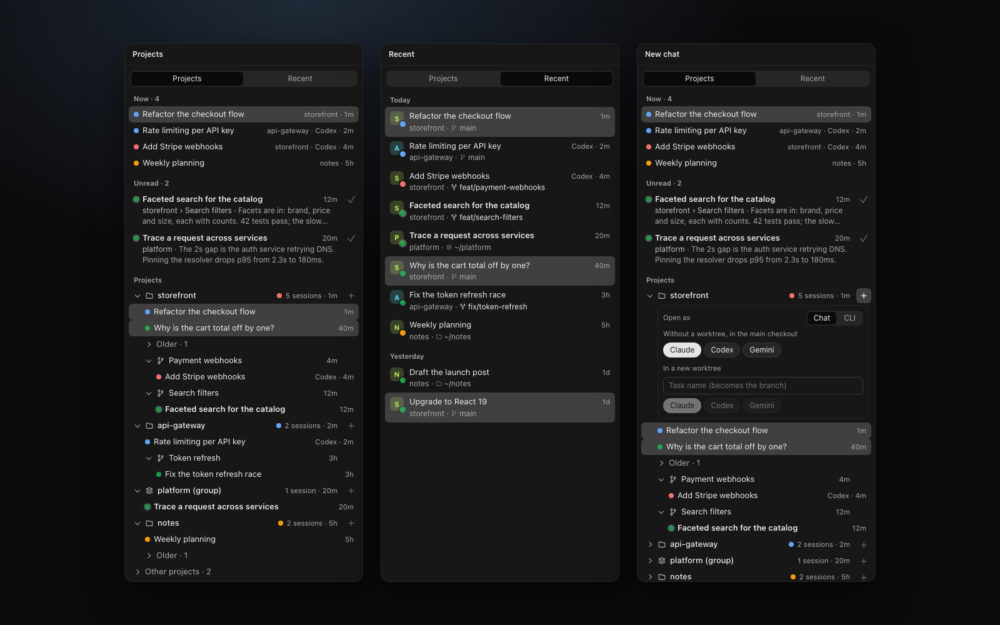
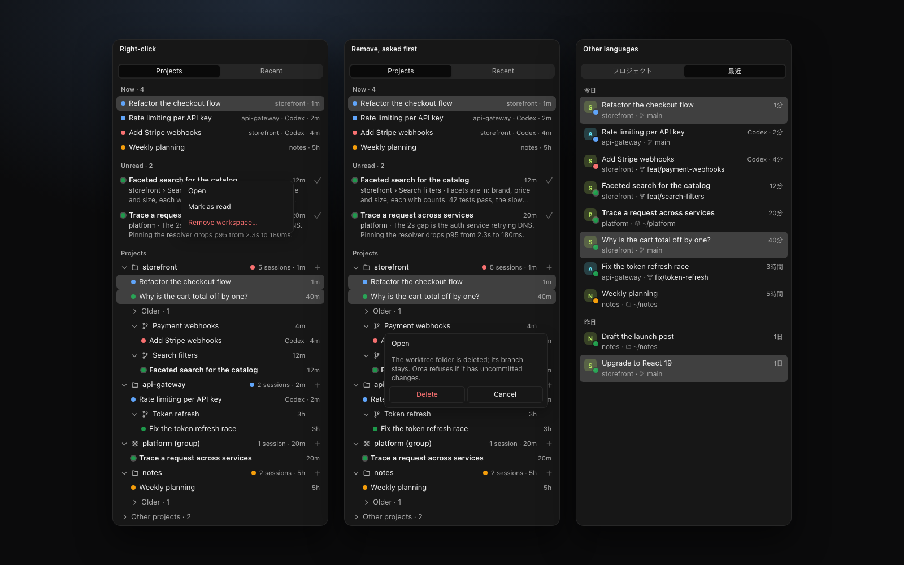

# Session Tree

Every agent session open in [Orca](https://github.com/stablyai/orca), in one tree by project, in the right sidebar.
On top: what is working, what waits for you and what finished while you were away.
Below: your projects, their worktrees and the sessions in each.
Start a chat from the `+` beside a project, with or without a worktree.



## What it shows

- **Now.** Agents that are working, need approval or wait for your answer, newest first.
- **Unread.** Agents that finished in a workspace you have not opened since, with the start of their last answer. ✓ marks it read. Opening the session does too.
- **Projects.** Each project's sessions in the main checkout, then each worktree with its own sessions. Folder groups and plain folders are listed too.
  - Sessions quiet for a day fold under *Older*.
  - Projects quiet for a day start folded.
  - Projects with nothing open sit under *Other projects*.
- **Recent.** Switch to a flat list of every open session, newest first, under *Today*, *Yesterday* and *Earlier*. Each row shows its project and branch, or the folder it runs in.

Native Orca chats are included: the panel lists what Orca's own sidebar lists.

## Starting a chat

`+` beside a project opens a small menu:

- **Open as Chat or CLI.** A native chat, or the agent in a terminal tab.
- **Without a worktree.** In the project's main checkout, a folder project's folder, or a folder group's latest workspace.
- **In a new worktree.** Type a task name, which becomes the branch, and pick the agent.

The agent you pick last is remembered. **New chat here, no worktree** (`Mod+Alt+N`) starts one in the current project with that agent.

If you want no new worktrees in a project at all, run **Ban or allow new worktrees in this project** from the command palette. Orca then refuses to create one there until you run it again.

## Right-click

| On | Menu |
| --- | --- |
| A session | Open · Mark as read / unread · Close tab (terminal agents) · Remove workspace… / Delete worktree… |
| A worktree | Open · Delete worktree… |
| A project | New chat… · Hide project in Orca |

Removal always asks first.

- **Delete worktree** runs Orca's own `worktree rm` without `--force`. Orca deletes the folder, keeps the branch, and refuses if there are uncommitted changes.
- **Remove workspace** makes Orca forget a workspace that is not a worktree. Its files stay.
- A project's main checkout, and any other workspace Orca opened on it, are never offered for removal.

Orca's plugin API has no way to put a workspace to sleep, so the menu does not offer it.



## Languages

The panel follows Orca's language: English, Русский, Deutsch, Español, Français, Português, Türkçe, 日本語, 한국어, 简体中文 and 繁體中文.
Terms come from Orca's own translations where it has them.
Languages other than English and Russian were translated with AI help, so corrections are welcome.

## Install

From Orca: **Settings → Plugins**, search for *Session Tree*.

From a terminal:

```sh
orca plugin install rmrfmybrain/orca-session-tree
```

Needs Orca 1.4.274 or newer. Then open the **Session Tree** panel in the right sidebar.

## How it works, and what it can touch

Session Tree is a `trusted-worker` plugin: its worker runs in a separate Node.js process with your user's access.
Orca shows what it asks for before you approve it:

- read projects, workspaces and agent status;
- open and hide workspaces and projects;
- its own storage.

Orca's plugin API does not list native chats yet, so the worker reads sessions through **Orca's own CLI**: the `orca` binary shipped inside the running Orca app, never one found on `PATH`. It is run with fixed arguments and no shell:

| When | Command |
| --- | --- |
| Panel open, every 15 s and on Orca's change events | `orca worktree ps --json` |
| Once per panel load | `orca agent installed --json` |
| You start a chat | `orca agent launch …` or `orca worktree create …` |
| You mark read or unread | `orca worktree set --read` / `--unread` |
| You close a tab | `orca terminal close --tab` |
| You confirm a removal | `orca worktree rm` |

Everything a command gets from the panel is validated first: workspace selectors, terminal ids, agent ids against the installed ones, and worktree names.

Nothing leaves your machine: no network requests, no telemetry.
The plugin stores only its own settings:

- which folds are open;
- the view;
- the last agent;
- Chat or CLI;
- projects with new worktrees banned.

**Platforms.** Tested on macOS.
The CLI paths for Linux (`resources/bin/orca-ide`) and Windows (`resources\bin\orca.exe`) are set but not yet tested.
Reports are welcome.

## Development

```sh
orca plugin types .      # generate typings into types/
orca plugin test .       # unit tests (view, model, worker against a fake Orca CLI)
orca plugin validate .
orca plugin install .    # load the working copy into your Orca
```

- `src/model.ts` turns `orca worktree ps` into sessions and targets.
- `src/view.ts` renders the panel as an HTML string.
- `src/frame.ts` wires it to the page.
- `src/worker.ts` runs the actions.
- Strings live in `src/i18n.ts`.

The screenshots are rendered from `view.ts` and `style.ts` on invented projects.

## Credits

Started from [SimplyCreateCode/projects-sessions-sidebar](https://github.com/SimplyCreateCode/projects-sessions-sidebar). The tree layout follows the Tree card style proposed for Orca's own sidebar.

## License

[MIT](LICENSE)
